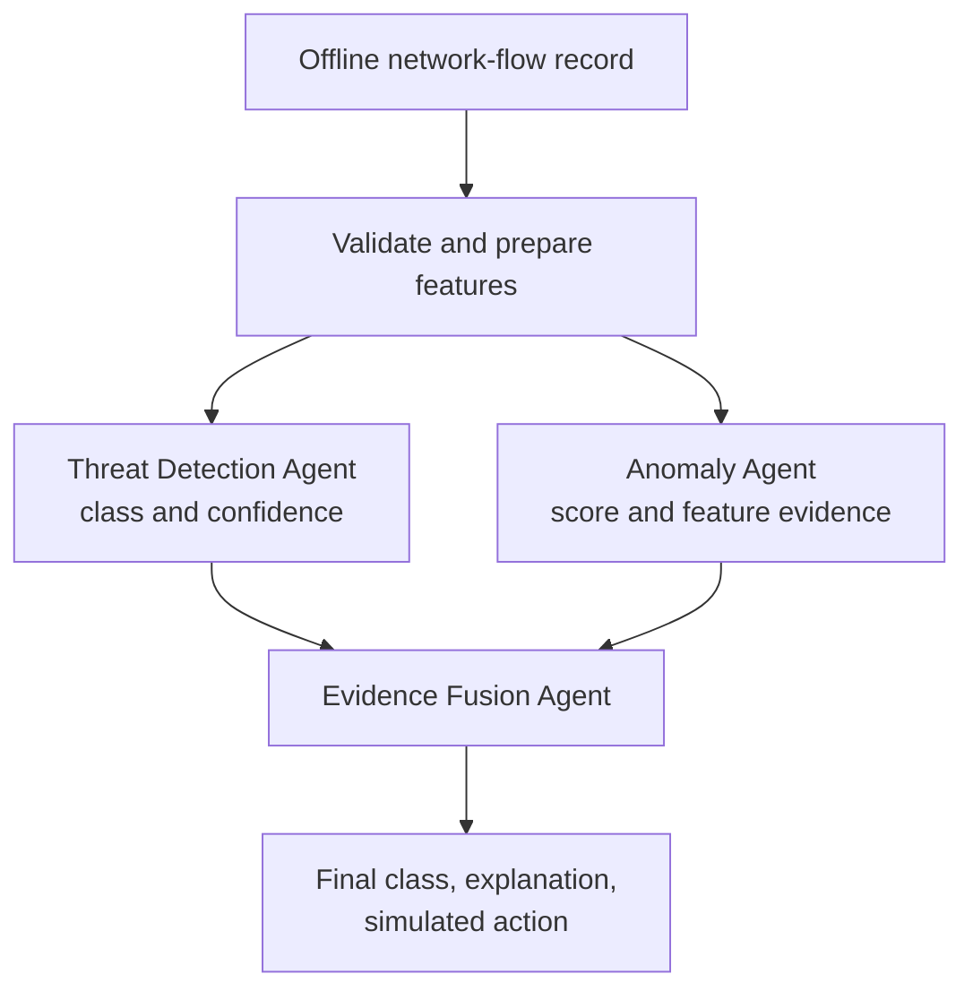

# CyberSentinel

**Multi-Agent Network Intrusion Detection & Adaptive Defense**  
JAI Agentic AI International Summit 2026 · Track 1: Agentic AI for Cybersecurity

CyberSentinel is an offline prototype that examines network-flow records, looks for known attack patterns and unusual behavior, and combines the evidence into an explainable recommendation. Its recommendations—`ALLOW`, `BLOCK`, or `REVIEW`—are simulated. It does not monitor a live network, launch attacks, or change a real firewall.

## Project goal

Given a network-flow record, the system is designed to:

1. Predict one of five traffic classes.
2. Independently score whether the flow looks unusual and identify supporting feature evidence.
3. Combine both agents' results, including disagreements, and return a final class, evidence status, explanation, and simulated action.

The prototype is intended for offline analysis and traffic replay.

## Data

The challenge uses labeled CICIDS2017 network-flow records. A flow is a summary of a network conversation, with measurements such as ports, duration, packet and byte counts, timing, and traffic flags. It is not the contents of messages sent over the network.

The five benchmark labels are:

| Label | Meaning |
|---|---|
| `BENIGN` | Normal traffic |
| `BRUTE_FORCE` | Repeated attempts to guess credentials |
| `DOS` | An attempt to overwhelm a service from one source |
| `DDOS` | An attempt to overwhelm a service using many sources |
| `PORT_SCAN` | Checking network ports to find available services |

The supplied training file has 456,737 rows and the evaluation file has 114,185 rows. The source tables contain 78 numeric measurements, a `record_id`, and a `label`. The provided evaluation rows must remain separate from training.

## How the system works



### 1. Prepare the flow

The data-preparation code checks that the input columns and labels are expected. It excludes `record_id` from model inputs because the ID can reveal label clues. It marks infinite values and impossible negative header lengths as invalid, removes constant and exact-duplicate feature columns, and fills invalid values using medians learned from training data. It applies the same fitted rules to evaluation data and keeps every row.

For the supplied data, the prepared model input has 71 numeric features plus the label. Raw and prepared challenge datasets are kept outside Git.

### 2. Threat Detection Agent

This supervised model predicts one of the five benchmark classes and returns a confidence value. The code includes a Random Forest baseline and an optional XGBoost backend, with class-aware training to account for uneven class counts.

The returned confidence is the model's highest predicted class probability. It is not calibrated, so it should be treated as a useful signal rather than a guarantee.

### 3. Anomaly Agent

This independent Isolation Forest model learns what BENIGN training flows look like. It returns an anomaly score and, when it flags a flow, feature evidence for measurements that differ from the learned benign range. It does not use the Threat Detection Agent's prediction when scoring a flow.

### 4. Evidence Fusion Agent

Fusion checks whether the two agents agree. The current policy uses a classifier-confidence threshold of `0.85`:

| Classifier result | Anomaly result | Evidence status | Simulated action |
|---|---|---|---|
| `BENIGN` with confidence at least 0.85 | Not anomalous | `AGREE` | `ALLOW` |
| Attack class with confidence at least 0.85 | Anomalous | `AGREE` | `BLOCK` |
| Classifier confidence below 0.85 | Any | Depends on agreement | `REVIEW` |
| Classifier and anomaly detector disagree | Any | `DISAGREE` | `REVIEW` |
| An agent's evidence is missing or invalid | Any | `INCOMPLETE` | `REVIEW` |

These are recommendations for offline replay only. The program never applies a real network control.

## Current implementation

The repository contains the flow-data preparation and audit code, the five-class classifier code, the independent anomaly detector and training script, the evidence-fusion rules, pipeline orchestration, and API endpoints for single-flow and batch analysis.

Model code is present, but trained model files are not included in the repository. The API stays fail-closed and reports that models are not ready until both verified model files are available. Official evaluation accuracy, macro-F1, and per-class results on the supplied evaluation file have not yet been produced. An internal report uses an incomplete training export, so it is not an official benchmark result.

The data-preparation, Threat Detection training/evaluation, and anomaly-training commands accept Parquet, so the prepared files can be used directly. The Threat Detection batch-prediction command currently reads CSV.

## Prepare the supplied data

Install the Python package with its machine-learning dependencies:

```bash
python -m venv .venv
source .venv/bin/activate
pip install -e ".[ml]"
```

Keep the organizer-provided files locally, then run the data preparation command:

```bash
python -m cybersentinel.data.cleaning \
  --train data/raw/training/flows.parquet \
  --eval data/raw/eval/flows.parquet \
  --out-dir data/processed
```

The command writes prepared Parquet files, fitted preprocessing state, and a dataset profile to `data/processed/`. These generated files and the raw challenge data should not be committed to the repository.

## API behavior

The FastAPI service provides health and model-status endpoints, plus single-flow and batch analysis endpoints. Analysis requires both trained model files. If either file is missing or cannot be loaded, the service returns `MODEL_NOT_READY` instead of producing a prediction.

## Evaluation

When the complete pipeline is trained, evaluate it on the untouched official evaluation split. Report overall accuracy, macro-F1, per-class precision/recall/F1, and a confusion matrix. Macro-F1 is especially useful when some classes have many fewer examples than others. Do not present internal or incomplete-data results as official benchmark performance.
