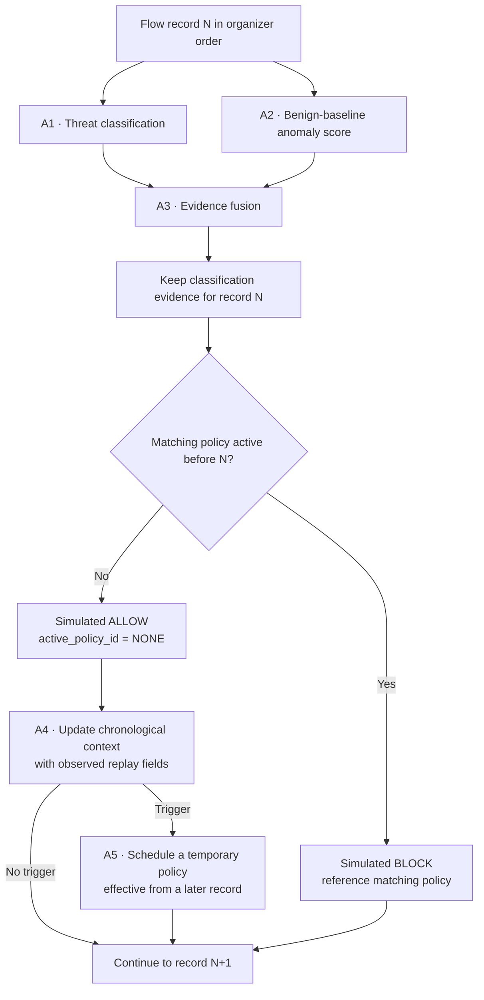
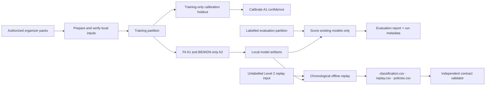

# CyberSentinel

**Multi-Agent Network Intrusion Detection & Adaptive Defense**  
*JAI Agentic AI International Summit 2026 · Track 1: Agentic AI for Cybersecurity*

CyberSentinel analyzes network-flow records with two learned detectors and three deterministic response agents. It combines classification, anomaly evidence, chronological correlation, and temporary policy simulation in an analyst console.

> **Scope:** The supported workflow is offline analysis and replay. <code>ALLOW</code> and <code>BLOCK</code> are simulated replay outcomes. CyberSentinel does not inspect live network traffic, inject packets, or change an operating-system firewall.

## 30-second overview

- **Problem:** A single flow label does not explain whether independent evidence agrees, activity forms a campaign, or a later policy should apply.
- **Approach:** Combine a supervised classifier and benign-baseline anomaly detector with evidence fusion, chronological correlation, and a forward-only policy lifecycle.
- **Outputs:** Per-record classification evidence, a chronological replay decision, and temporary simulated policies.
- **Emphasis:** Explainable evidence states, causal replay, traceable outputs, and clear limits on what the data can prove.

## Five-minute presentation route

| Time | Show | Presenter pointers |
|---|---|---|
| 00:00–00:35 | Project overview | Introduce the flow-analysis problem and the goal: combine independent signals with temporal context. |
| 00:35–01:30 | Architecture flowchart | Point out the two learned agents, three deterministic agents, and separation between evidence and replay action. |
| 01:30–02:45 | Analyst console | Use actual local artifacts: diagnostics, a flow inspection, evidence fusion, then chronological replay. Label manual inputs as what-if scenarios. |
| 02:45–03:45 | Replay flowchart | Explain that only a policy active before record N can block N; the trigger record cannot block itself. |
| 03:45–04:35 | Current evaluation report | Show only a fresh run with its code revision and input/model hashes. State the repeated-feature overlap caveat. |
| 04:35–05:00 | Submission contract | Show the three CSV outputs and independent validator. A local pass means schema consistency, not organizer acceptance. |

Before the demo, confirm data and model readiness with diagnostics, generate the run you plan to show, and keep its report and input hashes available. Do not present archived metrics as current results or infer hidden-set performance from the unlabelled replay.

## Runtime flow

A1 and A2 produce evidence for every record. The chronological gate checks policies active before that record. A blocked record remains in the classification output but does not update temporal or policy state.

### The five agents

| Agent | Role | Presenter pointer |
|---|---|---|
| **A1 · Threat Detection** | Supervised five-class classifier | Random Forest is the default (400 estimators in the combined trainer); XGBoost is optional. Classes: <code>BENIGN</code>, <code>BRUTE_FORCE</code>, <code>DOS</code>, <code>DDOS</code>, <code>PORT_SCAN</code>. Confidence uses the default training-only calibration holdout; <code>--calibration-fraction 0</code> disables calibration. |
| **A2 · Anomaly Detection** | Independent benign-baseline detector | Isolation Forest is fitted on BENIGN training rows. Its exported 0–1 anomaly index is higher for more anomalous flows; it is **not a probability**. The default operating threshold comes from benign training scores. |
| **A3 · Evidence Fusion** | Deterministic evidence combiner | Returns <code>AGREE</code>, <code>CONFLICT</code>, or <code>UNCERTAIN</code> with rationale. Evidence status is distinct from replay action. |
| **A4 · Temporal Correlation** | Chronological pattern analysis | Maintains a bounded 150-record window and uses organizer time fields when available (configured 300-second window). Correlates patterns such as scans, denial-of-service activity, and repeated authentication attempts. |
| **A5 · Adaptive Defense** | Simulated policy lifecycle | Checks existing policies and schedules temporary forward-only policies. A policy cannot block its own trigger. Policy scope uses literal observed endpoints, never synthetic identities. |

### Evidence is not the replay action

- A1/A2/A3 describe a record and the relationship between detector outputs.
- Replay action is <code>BLOCK</code> only when a matching A5 policy was active before the record.
- Without a match, replay action is <code>ALLOW</code>; <code>replay.csv</code> uses <code>active_policy_id=NONE</code>.
- A suspicious classification or fusion conflict alone does not prove that a policy blocked the record.
- A policy created during record N can affect later records, not N.

## Data and evaluation

The [data audit](docs/data-intelligence.md) documents the supplied labelled split:

| Split | Rows | Columns | Numeric flow features |
|---|---:|---:|---:|
| Training | 456,737 | 80 | 78 |
| Evaluation | 114,185 | 80 | 78 |

The 80 columns are 78 numeric flow measurements, <code>record_id</code>, and <code>label</code>.

| Class | Training rows | Evaluation rows |
|---|---:|---:|
| <code>BENIGN</code> | 240,000 | 60,001 |
| <code>BRUTE_FORCE</code> | 5,537 | 1,384 |
| <code>DOS</code> | 96,000 | 24,000 |
| <code>DDOS</code> | 57,600 | 14,400 |
| <code>PORT_SCAN</code> | 57,600 | 14,400 |

**Required caveat:** 8,161 distinct feature vectors occur in both splits and cover 9,795 evaluation rows (8.58%). This overlap can make repeated-flow results optimistic. Keep the official evaluation rows intact and disclose the overlap with any score.

### Data-use flow

- The combined trainer uses a deterministic stratified 15% holdout from training for A1 confidence calibration.
- A2 fits BENIGN rows and derives its default threshold from training scores. Label-based threshold selection requires a separate, explicitly permitted labelled validation set.
- The held-out evaluation partition is for scoring, not fitting or threshold selection.
- The documented Level 2 input contains 200 unlabelled records in organizer order. It has no ground-truth labels. Do not calculate hidden-set accuracy, macro-F1, attack recall, false-block rate, or containment from it.
- Organizer data, prepared files, fitted models, generated reports, and submission outputs are local artifacts ignored by Git.

### Results to present

- **A1:** Use a fresh labelled evaluation report; include macro-F1 and per-class results, especially for rare <code>BRUTE_FORCE</code>.
- **A2:** Distinguish ranking metrics from operational threshold results. Report threshold FPR/attack recall only when a labelled evaluation workflow measured them.
- **A3–A5:** Show the documented evaluation/replay workflow, configuration, and run metadata. Do not turn unlabelled replay counts into accuracy or containment claims.
- Record the code revision and dataset/model hashes for every run.
- Treat reports under <code>release/</code> as historical unless explicitly identified as current contract or audit documents. Regenerate before quoting metrics.

## Analyst console walkthrough

Use the console to show the workflow, not as evidence of live network telemetry:

1. **Overview / SOC Command Center** — five-agent schematic; 3D effects are illustrative.
2. **Five-Agent Architecture** — roles, parameters, and input/output contracts.
3. **Flow Inspector** — offline analysis of a supplied flow and model-returned anomaly evidence.
4. **Evidence Fusion** — backend decision rules; manual inputs are what-if scenarios.
5. **Temporal Investigations** — chronological campaign groups from available replay data.
6. **Adaptive Defense** — active and expired simulated policies.
7. **Replay Studio** — playback of generated artifacts and actual backend progress.
8. **Submission Studio** — CSV downloads and contract validation.
9. **Model Intelligence** — generated reports; missing reports remain unavailable.
10. **Audit / History / System Health** — local SQLite history, artifact readiness, and offline-scope disclosures.

If data, models, or reports are missing, the application should show an unavailable or empty state. A successful frontend build does not establish model readiness.

## Reproduce the local workflow

### 1. Prepare authorized inputs and dependencies

    python scripts/prepare_challenge_data.py \
      --training-pack cyber-pack.zip \
      --hidden-pack cyber-hidden.zip

    python -m pip install -e ".[dev,ml]"

The preparation script verifies supplied training/evaluation data against its manifest and validates the hidden replay input. Keep organizer files out of Git.

### 2. Train the learned agents

    python scripts/train_models.py \
      --train data/raw/training/flows.parquet

Artifacts are written locally to:

- <code>models/threat_detection/model.joblib</code>
- <code>models/anomaly_detection/model.joblib</code>

Do not use the hidden replay input or held-out evaluation split to fit, calibrate, or select thresholds. Use A2 validation tuning only when organizers permit it and provide a separate labelled partition.

### 3. Evaluate on the labelled evaluation partition

    python scripts/evaluate_benchmark.py \
      --eval data/raw/evaluation/flows.parquet \
      --threat-model models/threat_detection/model.joblib \
      --anomaly-model models/anomaly_detection/model.joblib \
      --output reports/generated/official_evaluation.json

Evaluation scores existing artifacts; it does not train models or tune thresholds. Include the repeated-feature overlap caveat.

### 4. Generate and validate the unlabelled replay bundle

    python scripts/generate_submissions.py \
      --input data/processed/hidden_replay_input.csv \
      --output-dir outputs/submission

    python scripts/validate_submissions.py \
      --input data/processed/hidden_replay_input.csv \
      --output-dir outputs/submission

A limited run is a smoke test only. A local validator pass confirms contract consistency; only an organizer response or receipt confirms acceptance.

### Submission contract

| File | Exact header | Key invariant |
|---|---|---|
| <code>classification.csv</code> | <code>record_id,predicted_class,anomaly_score,evidence_status</code> | One row per input in order; five-class prediction; finite anomaly index in [0,1]; evidence is <code>AGREE</code>, <code>CONFLICT</code>, or <code>UNCERTAIN</code>. |
| <code>replay.csv</code> | <code>record_id,action,active_policy_id</code> | One row per input in order; action is <code>ALLOW</code> or <code>BLOCK</code>; ALLOW uses <code>NONE</code>; BLOCK cites the lexicographically smallest matching active policy. |
| <code>policies.csv</code> | <code>policy_id,activated_after_record_id,scope_type,scope_value,expires_after_record_id</code> | Zero or more unique policies; exact observed endpoint scope; active from the next record through expiry, inclusive. |

The [Level 2 brief](docs/level2-brief.md) and [submission contract audit](release/benchmarks/submission-contract-results.md) define the schema used here. Recheck current organizer templates before submission; a changed template requires matching generator and validator updates.

## Run the local app

Prerequisites: Python 3.10+, Node.js 20+, and npm.

    python -m pip install -e ".[dev,ml]"
    npm install
    uvicorn api.index:app --host 127.0.0.1 --port 8000

In a second terminal:

    npm run dev

Vite proxies <code>/api</code> requests to FastAPI. See [deployment and runtime boundaries](docs/deployment.md).

Useful routes:

- <code>GET /api/health</code> and <code>GET /api/models/status</code> — API and model readiness.
- <code>GET /api/system/diagnostics</code> — local models, data, history, and submission artifacts.
- <code>POST /api/fusion/simulate</code> — production fusion contract for what-if inputs.
- <code>POST /api/replay/run-official</code> — run the installed hidden input and write the CSVs.
- <code>GET /api/replay/validate</code> — validate outputs against the original replay input.
- <code>GET /api/correlation/groups</code> — groups from the latest completed replay in this API process.

Example JSON and numeric values in the [API reference](docs/api.md) are illustrative placeholders, not measured results.

## Limitations and judge disclosures

- **Offline scope:** No live packet capture, socket monitoring, traffic injection, or host firewall changes.
- **Endpoint provenance:** Labelled CICIDS2017 features do not contain native Layer-3 endpoints. The hidden replay input provides literal endpoint fields. Missing or invalid endpoints remain unknown; no IP is derived from fingerprints or hashes.
- **Dataset scope:** Evaluation is documented for CICIDS2017. Transfer to other datasets and live environments is untested.
- **Fixed configuration:** Correlation windows and policy duration are bounded settings, not learned or self-adjusting parameters.
- **Model files:** Joblib uses Python pickle serialization. Load artifacts only from trusted provenance.
- **Deployment:** Data and models are ignored by Git. A normal Vercel build does not establish model readiness; full synchronous replay may exceed the configured 30-second function timeout, and SQLite history is local rather than durable shared storage. Do not describe the deployment as a production SOC service.
- **Historical reports:** Older release and QA reports may describe earlier code, results, or schemas; they are not current verification.

Read [judge disclosures](docs/judge-disclosures.md), [evaluation and replay](docs/evaluation.md), and [deployment boundaries](docs/deployment.md) before presenting.

## Third-party, reference, and AI disclosures

- **Project license:** MIT; see [LICENSE](LICENSE). Third-party packages and challenge datasets retain their own licenses and terms.
- **Dataset:** CICIDS2017 and organizer data are subject to provider and challenge terms. No challenge rows are committed.
- **AI assistance:** The team reports using Antigravity and ChatGPT for code review, debugging, test design, documentation, and UI implementation. Team members are responsible for understanding and presenting the submitted work.
- **UI reference:** The team reports reviewing the user-supplied <code>CICRCombined-main</code> archive for design patterns only and reports that no source files or components were copied. Verify the archive's license before any code reuse.
- **Architecture reference:** The team reports reviewing [Vaibhav-Patidar/cybersentinel](https://github.com/Vaibhav-Patidar/cybersentinel) for high-level pipeline and evidence-presentation ideas; no source files were reported as copied.

## Further reading

- [Architecture and API overview](docs/architecture.md)
- [API reference](docs/api.md)
- [Data audit](docs/data-intelligence.md)
- [Five-agent training and verification](docs/five-agent-training.md)
- [Evaluation, data boundaries, and replay](docs/evaluation.md)
- [Level 2 replay contract](docs/level2-brief.md)
- [Judge disclosures](docs/judge-disclosures.md)
- [Deployment and runtime boundaries](docs/deployment.md)
- [Current contract audits and historical report index](release/README.md)
