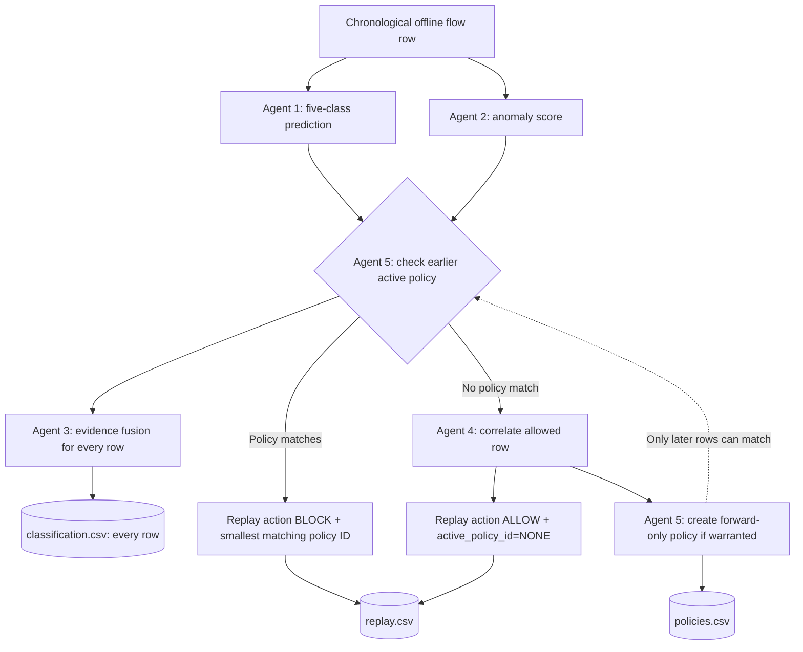

# CyberSentinel System Architecture

## Overview

CyberSentinel is an offline, five-agent network intrusion detection and adaptive defense framework built for JAI 2026 Hackathon Track 1. It evaluates CICIDS2017 network flow records across five benchmark classes using two independent detection agents, an evidence fusion matrix, a temporal correlation engine, and an adaptive policy manager.

## Five-Agent Responsibilities

1. **Agent 1 (Threat Detection Agent):**
   - Implements supervised five-class classification (`BENIGN`, `BRUTE_FORCE`, `DOS`, `DDOS`, `PORT_SCAN`).
   - Uses the current `RandomForestClassifier` backend by default (400 estimators, `balanced_subsample` class weights); XGBoost is an optional backend. Missing and infinite numeric values are median-imputed from training data.
   - Outputs the predicted class and maximum `predict_proba` confidence. It remains uncalibrated unless the optional scalar temperature-calibration workflow is run on a separate labelled held-out validation set.

2. **Agent 2 (Anomaly Detection Agent):**
   - Independent baseline trained strictly on benign baseline network traffic.
   - Uses a 200-tree Isolation Forest trained on benign training rows. The baseline threshold is the first percentile of benign training decision scores; an optional separate labelled validation workflow can select a threshold under a configured benign false-positive ceiling. The exported 0–1 anomaly index is not a probability.
   - Flags deviations without consuming Agent 1 outputs or labels.
   - Extracts feature-level evidence tags (e.g., `unusual_packet_rate`, `abnormal_flow_duration`).

3. **Agent 3 (Evidence Fusion Agent):**
   - Orchestrates deterministic consensus between Agent 1 and Agent 2.
   - Emits the organizer evidence states `AGREE`, `CONFLICT`, and `UNCERTAIN`.
   - Routes conflicting or incomplete evidence to analyst review rather than fabricating certainty.

4. **Agent 4 (Temporal Correlation Agent):**
   - Maintains a stateful 150-flow sliding window across arrival order.
   - Correlates allowed flows using only literal observed source/destination endpoints and organizer timestamps. Missing or invalid endpoints remain unknown; no fingerprint-derived or synthetic identity is permitted. DDoS and brute-force heuristics require matching A1 attack-class evidence; ordinary web fan-in or repeated benign SSH flows alone do not trigger those campaigns.
   - Extracts target endpoints, member records, and threat group IDs.

5. **Agent 5 (Adaptive Defense Agent):**
   - Evaluates active policies before newly allowed flows are analyzed.
   - Generates temporary `SOURCE_IP` quarantine policies from literal observed source endpoints only, with explicit activation and expiration boundaries (`expires_after_record_id`). Missing or invalid source IPs cannot produce a policy; the default 150-position lifetime is capped to the remaining replay records.
   - Strictly enforces that the triggering flow is never self-blocked.
   - Never applies live firewall changes; all policies are simulated within the replay framework.

## Replay Engine & Causal Invariants

The chronological replay engine enforces strict causality guarantees:
- **Arrival-Order Processing:** Flows are evaluated strictly sequentially.
- **Causal Pre-Filter:** The active-policy check is evaluated in chronological order; only policies activated before record $N$ can block record $N$. A1/A2 classification and A3 evidence status are still emitted for every row, including rows later blocked. A blocked row is excluded from Agent 4 correlation and Agent 5 policy updates.
- **Universal Forensics:** Every flow, including those blocked by earlier policies, is classified in `classification.csv`.
- **Zero Label Leakage:** Ground-truth labels are never accessed during replay decision making.

## Organizer CSV Contract

- `classification.csv`: `record_id,predicted_class,anomaly_score,evidence_status`
- `replay.csv`: `record_id,action,active_policy_id`; ALLOW uses `NONE`, BLOCK uses the lexicographically smallest matching active policy.
- `policies.csv`: `policy_id,activated_after_record_id,scope_type,scope_value,expires_after_record_id`; zero or more rows, no action column.
- Scope types are `SOURCE_IP`, `DESTINATION_IP`, and `SRC_DST_PAIR`; scope values must match observed endpoint fields exactly. Activation is exclusive and expiry inclusive.
